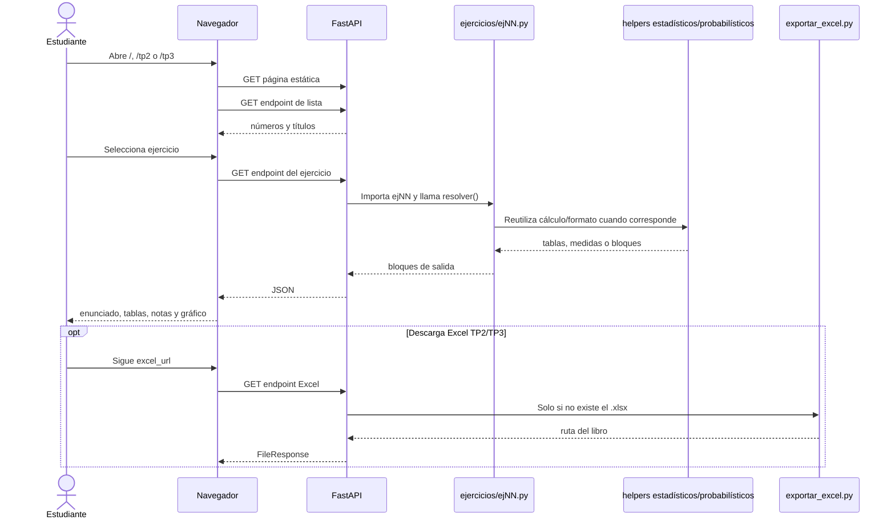
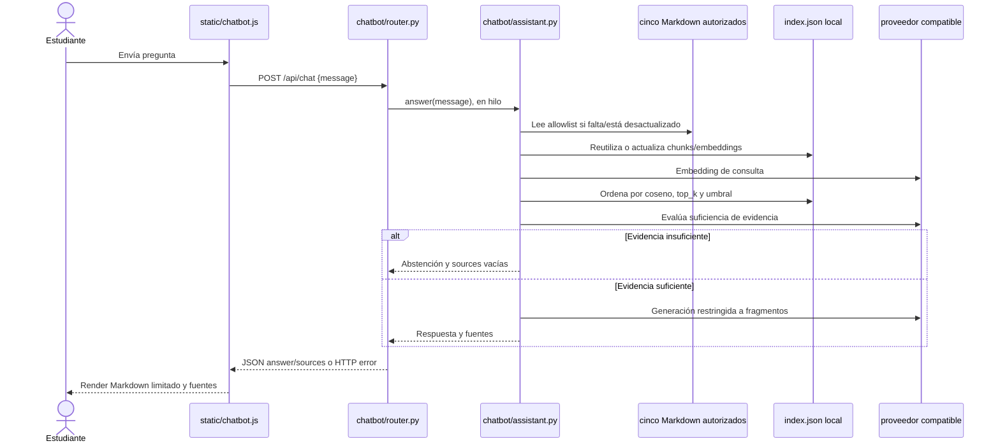

# Arquitectura de la aplicación

## Resumen

El proyecto reúne tres componentes dentro de la misma aplicación: resoluciones estadísticas, interfaz web y chatbot académico RAG. FastAPI en [`main.py`](../../main.py) carga módulos de ejercicios y también incluye un router de chatbot; el navegador recibe páginas estáticas y usa JavaScript para los resultados y el chat. No se identificó base de datos ni framework frontend.

El chatbot sí está implementado en [`chatbot/`](../). Su servicio recupera información exclusivamente de cinco Markdown autorizados, usa un índice vectorial JSON local y un proveedor externo compatible con la API OpenAI configurado por variables de entorno. Requiere credenciales/modelos configurados para responder; sin configuración, el endpoint de salud informa que no está operativo.

## Organización de carpetas

```text
tp1_app/
├── main.py                    # Aplicación FastAPI y rutas
├── estadistica.py             # Helpers descriptivos y bloques JSON
├── probabilidad.py            # Conteo Laplace, Bayes y helpers TP2
├── distribuciones.py          # Binomial, Poisson, geométrica y momentos
├── ejercicios/                # TP1: 10 módulos
├── ejercicios_tp2/            # TP2: 17 módulos
├── ejercicios_tp3/            # TP3: 25 módulos
├── exportar_excel.py          # Exportación por ejercicio (openpyxl)
├── generar_excel.py           # Libro TP1 consolidado
├── static/
│   ├── index.html             # Página TP1
│   ├── tp2.html, tp3.html     # Páginas TP2/TP3
│   ├── js.js                  # Lógica de interfaz compartida
│   ├── chatbot.js             # Cliente del asistente académico
│   ├── style.css              # Temas y diseño adaptable
│   └── public/                # Recursos gráficos
├── docs/                      # PDFs TP2 y TP3; no se encontró PDF TP1
├── excel/                     # Libros generados/conservados
├── tests/test_chatbot.py      # Pruebas unitarias del RAG y router
├── .env.example               # Nombres de variables de configuración
└── chatbot/
    ├── router.py              # Esquemas y rutas /api/chat
    ├── assistant.py           # Indexación, recuperación y generación RAG
    ├── prompts.py             # Instrucción del sistema
    ├── README.md              # Operación/configuración
    ├── knowledge/             # Cinco fuentes permitidas
    └── vector_db/index.json   # Índice generado localmente e ignorado por Git
```

Los directorios `excel/`, `chatbot/vector_db/` y `__pycache__/` contienen salidas/cachés, no lógica fuente. Los requisitos directos Python están en [`requirements.txt`](../../requirements.txt). `.env.example` es una plantilla: no se incluye aquí ningún secreto.

## Capas y responsabilidades

### Capa de ejercicios

Cada `ejNN.py` declara `TITULO`, `ENUNCIADO` y `resolver()`. El resolver calcula sus resultados y devuelve una lista de bloques compatibles con la API. Los ejercicios reutilizan lógica común según el tema:

- TP1: medidas y formatos de [`estadistica.py`](../../estadistica.py).
- TP2: probabilidad, fracciones, tablas y bloques de [`probabilidad.py`](../../probabilidad.py), además de formatos estadísticos.
- TP3: distribuciones y momentos de [`distribuciones.py`](../../distribuciones.py), además de formatos comunes.

No hay un objeto persistente que guarde los resultados: el endpoint ejecuta el resolver cuando se solicita el ejercicio.

### Capa de servicio

[`main.py`](../../main.py) instancia `FastAPI`, define los rangos de ejercicios, importa dinámicamente los módulos y expone las rutas. `registrar_tp(...)` registra de forma común las rutas TP2 y TP3. No se usan módulos `APIRouter` independientes.

La excepción es el chatbot: [`chatbot/router.py`](../router.py) define un `APIRouter` prefijado `/api/chat`, que `main.py` incluye antes del montaje de archivos estáticos.

### Capa de presentación

- HTML semántico estático para las páginas y los glosarios.
- JavaScript vanilla (`static/js.js`) para solicitudes, navegación, tablas, notas y gráficos.
- JavaScript independiente (`static/chatbot.js`) para el panel flotante del asistente, estado del servicio y mensajes.
- CSS vanilla para layout, temas claro/oscuro y adaptación responsiva.
- Chart.js se carga desde CDN para gráficos; no es una dependencia Python.

### Capa de exportación

[`exportar_excel.py`](../../exportar_excel.py) crea archivos individuales usando openpyxl. [`generar_excel.py`](../../generar_excel.py) crea un libro TP1 consolidado. El endpoint de Excel TP2/TP3 devuelve un archivo existente o lo genera si falta. TP1 usa enlaces predefinidos a planillas externas en `main.py`, no un endpoint local de descarga.

### Capa RAG del chatbot

[`chatbot/assistant.py`](../assistant.py) carga los Markdown autorizados, los divide en fragmentos y crea embeddings mediante un proveedor externo compatible con `/embeddings`. Guarda vectores y metadatos en `chatbot/vector_db/index.json`. Para cada consulta, calcula el embedding, ordena por similitud coseno, filtra por umbral y `top_k`, y evalúa si la evidencia alcanza antes de pedir la respuesta generativa. Devuelve respuesta y referencias a archivo/sección, o se abstiene. No consulta los módulos de ejercicios en tiempo real; usa el contenido de los cinco Markdown.

## Rutas HTTP

| Ruta | Función |
|---|---|
| `GET /` | FastAPI `StaticFiles` sirve `static/index.html` como raíz. |
| `GET /api/ejercicios` | Lista número y título del TP1. |
| `GET /api/ejercicios/{n}` | Devuelve título, enunciado, enlace Excel y bloques de resolución TP1. |
| `GET /tp2` y `GET /tp3` | Sirven las páginas estáticas respectivas. |
| `GET /api/tp2/ejercicios`, `GET /api/tp3/ejercicios` | Listan los ejercicios del TP correspondiente. |
| `GET /api/tp2/ejercicios/{n}`, `GET /api/tp3/ejercicios/{n}` | Ejecutan el resolver y devuelven sus bloques en JSON. |
| `GET /api/tp2/excel/{n}`, `GET /api/tp3/excel/{n}` | Devuelven Excel local; lo generan solo si el archivo no existe. |
| `POST /api/chat` | Recibe una consulta de hasta 2000 caracteres; devuelve respuesta y fuentes, o error/abstención. |
| `GET /api/chat/health` | Informa disponibilidad de documentos, índice y configuración de modelos. |
| `POST /api/chat/reindex` | Reconstruye el índice si se presenta el token administrativo configurado. |
| `/docs`, `/redoc`, `/openapi.json` | Documentación/esquema automático de FastAPI. |

`cargar()` y el cierre `cargar_tp()` verifican el número contra el rango de cada TP. Si no está permitido, se lanza HTTP 404. Para TP2 y TP3, los rangos son 1–17 y 1–25; para TP1, 1–10.

## Contrato de datos entre backend y navegador

El resolver entrega bloques con los siguientes elementos, algunos opcionales:

```json
{
  "subtitulo": "Distribución",
  "columnas": ["x", "P(X = x)"],
  "filas": [[0, 0.25]],
  "grafico": {
    "etiquetas": ["0"],
    "series": [{"nombre": "Frecuencia", "valores": [0.25]}]
  },
  "notas": ["Nota explicativa"]
}
```

En cada ejercicio, la API agrega `numero`, `titulo`, `enunciado`, `excel_url` y `bloques`. La forma exacta de las filas y columnas depende de cada módulo; TP2 puede mostrar fracciones como texto y decimales, mientras TP1/TP3 redondean los valores numéricos de presentación.

## Flujo completo de una consulta de ejercicio



### Flujo del chatbot



### Recorrido del valor

1. El usuario abre la página. FastAPI sirve un HTML estático; no genera una página mediante plantilla.
2. `js.js` lee `document.body.dataset.api`. TP1 usa `/api/ejercicios`; TP2/TP3 declaran su ruta en el HTML.
3. `cargarMenu()` solicita la lista JSON, construye botones y abre el primer ejercicio.
4. `mostrar(n)` solicita el endpoint del ejercicio. FastAPI verifica el número, importa `ejNN.py` y ejecuta `resolver()`.
5. El resolver devuelve bloques; FastAPI serializa el resultado. No hay una capa de caché en la ruta.
6. El navegador convierte `columnas`/`filas` en `<table>`, `notas` en lista y las series del gráfico en Chart.js.
7. El enlace `excel_url` permite abrir/descargar el libro asociado.

## Generación y almacenamiento Excel

`exportar_excel.py` construye un libro individual por ejercicio. Cada hoja incluye título, enunciado, bloques, notas y gráficos cuando el bloque los proporciona; para el gráfico escribe una tabla auxiliar y la referencia con `openpyxl.chart.Reference`. También aplica bordes, anchos y configuración de página horizontal.

`exportar_excel.py --tp2` genera `excel/tp2/ejercicio_NN.xlsx`; `--tp3` genera `excel/tp3/ejercicio_NN.xlsx`. TP3 aplica formatos numéricos para decimales y probabilidades. `generar_excel.py` produce `excel/ejercicios.xlsx`, con una pestaña de resumen y una pestaña por ejercicio TP1.

**Limitación de actualización:** las rutas TP2/TP3 no regeneran un archivo ya existente. Los libros `excel/tp3/ejercicio_02.xlsx`, `_05.xlsx` y `_11.xlsx` tienen fecha de modificación 16/11/2026, anterior a las correcciones actuales de sus resolvers. No se comprobó su contenido celda por celda; por eso pueden no coincidir con el código. Regeneración dirigida: `python exportar_excel.py --tp3 2 5 11`.

## Tecnologías y datos persistentes

- FastAPI sirve páginas, JSON y archivos; Uvicorn ejecuta la aplicación.
- pandas representa y opera sobre datos tabulares.
- openpyxl escribe los `.xlsx`.
- HTML/CSS/JavaScript implementan la interfaz; Chart.js dibuja los gráficos.
- El servicio RAG usa la biblioteca HTTP estándar y almacena el índice vectorial como JSON local; no hay base de datos ni almacenamiento de historial de chat.
- El proveedor de embeddings/generación es externo y compatible con endpoints de estilo OpenAI; requiere configuración en servidor. No se comprobó conectividad real en esta documentación.
- Los PDFs disponibles son TP2 y TP3. En TP1 no hay consigna PDF en `docs/`; algunas tablas/figuras de TP2/TP3 no se pueden verificar solo mediante extracción de texto.
- El comando documentado para desarrollo es `uvicorn main:app --reload`; las rutas de `main.py` ofrecen `/docs` y `/redoc`.

## Estado del chatbot

La implementación está en [`chatbot/assistant.py`](../assistant.py) y [`chatbot/router.py`](../router.py); el cliente es [`static/chatbot.js`](../../static/chatbot.js), el prompt está en [`chatbot/prompts.py`](../prompts.py) y la operación se describe en [`chatbot/README.md`](../README.md). `main.py` registra el router antes del montaje estático.

El endpoint acepta un mensaje de 1–2000 caracteres; no se envía historial. El router limita a cuatro operaciones concurrentes, usa un timeout de 50 segundos para chat y 180 para reindex. La reindexación requiere el encabezado administrativo. `/api/chat/health` informa si hay documentos, índice y modelos configurados. Sin configuración de proveedor, el chat no está disponible.

La restricción temática se implementa en el servidor mediante allowlist de cinco archivos, búsqueda vectorial, umbral, evaluación adicional de evidencia y prompt de abstención. Esto indica el diseño real, no una garantía de infalibilidad del modelo. El índice local `chatbot/vector_db/index.json` no se versiona; al cambiar contenido se detectan hashes y se actualizan documentos. `tests/test_chatbot.py` prueba casos unitarios con mocks, pero no una llamada a un proveedor real.

## Referencias cruzadas

- Detalle de resoluciones: [`tp1.md`](./tp1.md), [`tp2.md`](./tp2.md), [`tp3.md`](./tp3.md).
- Manual de módulos y flujos: [`programacion.md`](./programacion.md).
- Código principal: [`main.py`](../../main.py), [`estadistica.py`](../../estadistica.py), [`probabilidad.py`](../../probabilidad.py), [`distribuciones.py`](../../distribuciones.py).
- Interfaz: [`static/index.html`](../../static/index.html), [`static/tp2.html`](../../static/tp2.html), [`static/tp3.html`](../../static/tp3.html), [`static/js.js`](../../static/js.js), [`static/style.css`](../../static/style.css).
- Chatbot: [`chatbot/router.py`](../router.py), [`chatbot/assistant.py`](../assistant.py), [`chatbot/prompts.py`](../prompts.py), [`static/chatbot.js`](../../static/chatbot.js), [`chatbot/README.md`](../README.md) y [`tests/test_chatbot.py`](../../tests/test_chatbot.py).